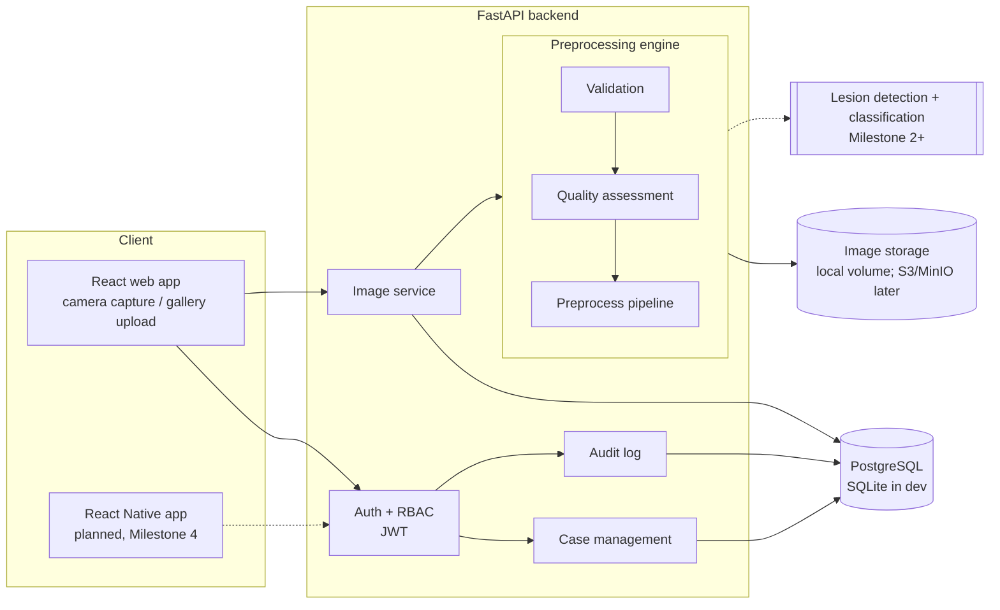

# DermAI architecture (Milestone 1)

## Request flow: image upload
1. Client picks or captures a photo and calls `POST /api/images/check-quality` (nothing stored).
2. User sees blur / brightness / contrast meters and issues; poor images cannot be confirmed.
3. On confirmation `POST /api/cases/{id}/images` validates (format, size, resolution, decodable), assesses quality, stores the original, and, unless the image is poor, runs the preprocessing pipeline and stores the preview.
4. Image row is `pending` (ready for the model) or `rejected_quality`.

## Analysis flow (Milestone 2)
After an image passes validation and the quality check, `services/analysis.py` runs:
1. **Lesion detection** (`preprocessing/lesion.py`): finds the lesion, saves an overlay with its outline and stores `lesion_info` (JSON).
2. **ROI preprocessing**: crops to the detected lesion instead of the centre, then runs the same preprocessing steps.
3. **Classification** (`inference/classifier.py`): runs the deployed TorchScript model if one exists and PyTorch is installed. It stores `model_version` and `prediction_result` (JSON) and sets the status to `completed`.

With no deployed model, or no PyTorch, the upload still works and the image stays `pending`. `GET /api/models/active` reports the deployed model, `POST /api/models/reload` loads a newly exported one, and `POST /api/models/reanalyze` re-runs analysis on an existing image. The original, preprocessed and lesion-overlay images are served from `GET /api/images/{id}/file?variant=original|processed|lesion`.

## Milestone 3 additions
After classification `services/analysis.py` also runs:
1. **Risk category** (`inference/risk.py`): maps the summed probability of the malignant classes to Low / Moderate / High using thresholds fitted from validation data (`risk.json`, see [risk_protocol.md](risk_protocol.md)); Requires Clinical Review when a low-risk label would rest on an unlocated lesion.
2. **Attention map** (`inference/explain.py`): Grad-CAM (or Grad-CAM++) between the model's `features.ts.pt` and `head.ts.pt`; an ensemble averages the maps of its members. The overlay is stored as `images.cam_path` and served as `GET /api/images/{id}/file?variant=cam`. The share of attention inside the detected lesion is stored in `prediction_result.explain`.
3. **Notifications** (`GET /api/notifications`): derived on request from the analyses a user can see (poor quality, low confidence, clinical review recommended, follow-up due, analysis completed or failed). No stored state.
4. **Model registry** (`GET /api/models/versions`, `POST /api/models/activate`): list versions with their evaluation, deploy or roll back, audit-logged.
`GET /api/images/{id}` returns one analysis (role-shaped) for the analysis screen at `/analysis/:id`.

A model folder may now hold: `model.ts.pt`, `meta.json`, `risk.json`, `features.ts.pt` + `head.ts.pt` (or `m0/`, `m1/` ... for an ensemble). Missing optional files just switch that feature off.

## Preprocessing pipeline (`backend/app/preprocessing`)
EXIF orientation fix, RGB, centre square crop, resize 224, NLM denoise, gray-world colour normalisation, CLAHE on lightness, unsharp mask, ImageNet normalisation to CHW float32. The centre crop is a placeholder for lesion-aware ROI extraction (Milestone 2).

## Security
bcrypt password hashing, short-lived JWT bearer tokens, role-based access (patient, dermatologist, researcher, ml_engineer, admin), self-registration limited to patient/researcher, ownership checks on every case/image route (404 rather than 403 to avoid ID probing), audit log of auth, case and image events, upload size and type limits.

## Roles and permissions
See [role_permissions.md](role_permissions.md) for the full matrix of what each of the five roles can see and do.

The entry page is a three-way carousel (swipe, arrows or tabs). Each role has its own sign-in and sign-up pair, its own fields, and its own theme: soft and rounded for patients, graphite and blue for clinicians, graphite and indigo for researchers. The theme follows the user after sign-in. Staff accounts use a separate "Staff sign in".

## Deliberately deferred
OAuth2 social login, Alembic migrations, S3/MinIO storage, React Native app, image crop/rotate UI, segmentation and classification (Milestone 2+).

