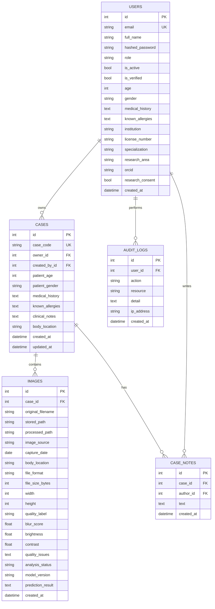

# Database schema

Mapping to the brief's case fields: Case ID = `cases.case_code`, Image ID = `images.id`, image capture date, body location, image source, analysis status, model version and prediction result all live on `images`. `model_version` and `prediction_result` (JSON) stay empty until the classifier is added in Milestone 2.

SQLAlchemy models in `backend/app/models/models.py` are the source of truth; tables are created at startup. Add Alembic before the first schema change after deployment.

## Analysis columns on `images` (Milestone 2)
- `lesion_path`: file path of the overlay image with the lesion outline.
- `lesion_info`: JSON from lesion detection.
- `model_version` and `prediction_result` (JSON): filled by the classifier when a model is deployed, otherwise empty.

## Milestone 3
- `images.cam_path`: file path of the Grad-CAM attention overlay (empty without an explainability-enabled model).
- `images.prediction_result` (JSON) now also holds `risk` (category, key, recommendation, p_malignant, reasons, protocol) and `explain` (method, target, attention_in_lesion, lesion_share_of_crop). Notifications are derived, not stored.

## Role-specific profile fields (`users`)
| Role | Fields collected at sign-up / profile |
|---|---|
| Patient / General User | age, gender, relevant medical history, known allergies (pre-fill new cases) |
| Dermatologist / Clinician | institution, licence / registration number (required), specialisation |
| Medical Researcher | institution (required), research area, ORCID iD |

Fields outside a role's list are discarded by the API. `is_verified` is false for self-registered clinicians until an administrator verifies them; only verified clinicians and admins can see other users' cases. Changing a clinician's licence number resets verification.

## Case notes
`case_notes` is a timeline: every note records its author and role, so patient remarks and clinical notes stay distinguishable. `cases.clinical_notes` holds the optional note entered at case creation.

## Upgrading an older database
On startup `app/db/migrate.py` adds any columns missing from an existing database, so an older `dermai.db` keeps working. Use Alembic before holding real data.

## Added with the permission matrix
- `users.research_consent`: a patient's opt-in for de-identified use by researchers and ML engineers.
- `cases.created_by_id`: the clinician who opened a case on a patient's behalf (`owner_id` stays the patient).

